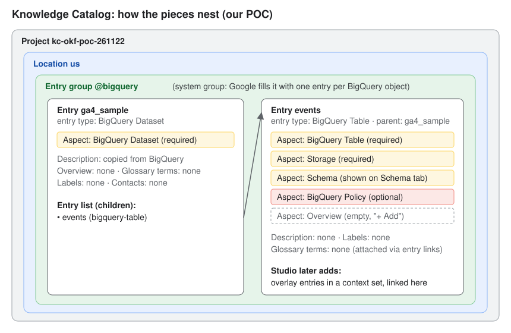

# Knowledge Catalog concepts, in plain words

| Term | Plain meaning | .NET / SQL Server analogy | In our POC |
|---|---|---|---|
| **Knowledge Catalog** | Google's metadata database: facts *about* your data, not the data itself | `sys.*` catalog views plus extended properties, for all of GCP | the console area "Knowledge Catalog" |
| **Project** | The GCP container for everything | a solution | `kc-okf-poc-261122` |
| **Location** | Where the metadata lives; matches the data's location | a server region | `us` |
| **Entry group** | A folder of entries. `@bigquery` is a **system** group that Google fills automatically; you can make your own (a context set is one) | a schema such as `dbo` | `@bigquery` |
| **Entry** | One record per data object: a dataset, table, view, file, or a custom thing | one row in `sys.objects` | `ga4_sample` (dataset), `events` (table) |
| **Entry type** | What kind of entry it is; decides which aspects are required | the object's class | BigQuery Dataset, BigQuery Table |
| **Entry list** | The child entries of an entry (a dataset's tables) | expanding a database node in Object Explorer | `ga4_sample` → `events` |
| **Aspect** | A typed block of fields attached to an entry. Schema, storage, overview and contacts are all aspects; you can define your own | an extended property, but with a typed schema (like a C# class instance attached to the object) | BigQuery Table, Storage, BigQuery Policy |
| **Aspect type** | The definition (schema) of an aspect. Listed under *Metadata types* | the C# class | `dataplex-types.global.overview`, etc. |
| **Required / optional aspect** | Required ones come with the entry type and Google maintains them; optional ones you (or an agent) add | | Overview is optional and empty |
| **Description** | One short text field on the entry, copied from BigQuery | `MS_Description` | dataset: yes (we set it in `bq mk`); table: none |
| **Labels** | Key/value tags copied from BigQuery | | none |
| **Glossary / term** | Business vocabulary ("Session", "Conversion") stored as entries, attached to tables or columns by **entry links** | a data dictionary | none yet |
| **Entry link** | A typed link between two entries: `synonym`, `related`, `definition`, `reference` | a foreign key between metadata rows | Studio will use `reference` links |
| **Context set** (Studio) | An entry group of type `context-set` that holds Studio's overlay entries for agents | a separate schema of curated views | created in step 3 |

## Terms added during steps 3 to 5

| Term | Plain meaning | .NET / SQL Server analogy | In our POC |
|---|---|---|---|
| **Knowledge Studio enrichment task** | A saved job: which context set, which tables, which documents ("knowledge signals"), which eval set, run as which service account | a SQL Agent job definition | `ga4-events-enrichment` (us-central1) |
| **Run** | One execution of the task; it drafts pages, evaluates them, and stages a change request | one job execution, with its history | `d3704062-...`, 29 min |
| **Knowledge signal** | A document source Studio reads (GCS bucket/folder/file, glossary; external: Drive, Confluence, Jira, GitHub, SharePoint) | the spec documents you give a developer | `gs://kc-okf-poc-261122-signals` |
| **Evaluation set** | Questions plus golden SQL; Studio tests agents with them before and after its draft | a unit-test suite | 12 questions, JSONL in `gs://kc-okf-poc-261122-eval` |
| **Change request** | A batch of proposed metadata changes waiting for approval; approve / remove per page; author can't approve their own | a pull request | `345f4080-...` (Studio, approved), `919699e7-...` (ours, pending) |
| **Document entry** | A context-set page: `context-set` / `knowledge-base-root` (front page), `knowledge-base-index` (folder index), `table-context`, `knowledge-base` (topic page). Text in the overview aspect | a wiki page stored as a row | `agents`, `documents/...`, `assets/.../events` |
| **Tracer fact** | A made-up fact planted in one source so we can see whether, and where, it shows up | a canary value in test data | "MSC-417", "Digital Insights Guild", the 72-hour rule |
| **OKF** | Open Knowledge Format: Markdown files with YAML frontmatter in folders, `index.md` per folder; v0.3, vendor-neutral since 2026-11-18 | a `.bacpac`: portable export you can read without the server | `results/04-okf/pull-after-push/bundle/` |
| **kcmd** | Google's "metadata as code" CLI: `init`, `pull`, `push`, `mcp` | `git` plus `sqlpackage` for metadata | 0.2.5 |
| **MCP** | Model Context Protocol: a standard way for an agent to call tools in another process | a Web API the agent calls | `kcmd mcp` serves `list-entries`, `lookup-entry`, `modify-entry` |
| **Playbook** | Process knowledge: "for this kind of question, do these steps, run this SQL" | a runbook / stored procedure with comments | `documents/playbook-final-daily-net-revenue` |
| **Service agent vs service account** | The service *agent* is a Google-owned login per project that impersonates *our* service account (the "Run as" identity) | IIS app-pool identity switching to a domain account | `service-…@gcp-sa-dataplex…` → `kc-studio-enricher@…` |
