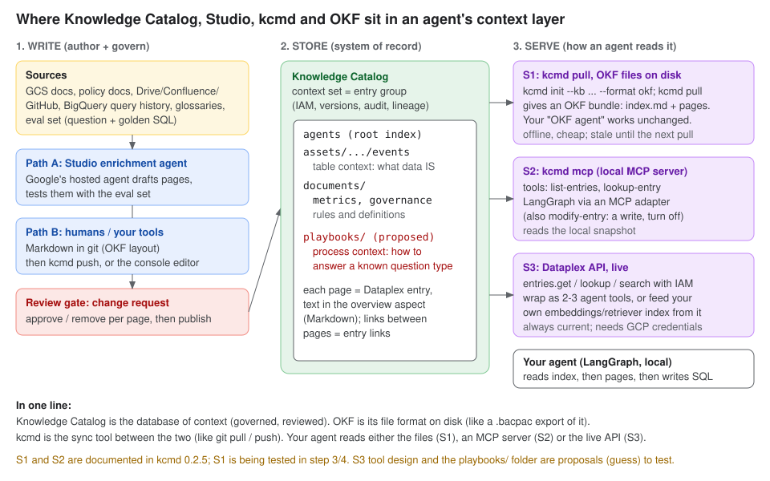

# Where OKF fits, and how an outside agent uses Knowledge Catalog context

A sidebar written during step 3 (2026-11-22), answering two questions:

1. If I already have agents with a context layer (a retriever over GCS docs, or an agent that reads OKF Markdown), where do Knowledge Catalog, Studio, kcmd and OKF fit? How does an agent built **outside** Google (for example LangGraph on a laptop) read the context we build in Knowledge Catalog?
2. Table knowledge is only half of it. Where does **process context** go, meaning playbooks like "for this kind of question, take this approach, use these columns, run this SQL"?

Labels: **verified** = we saw it in this POC. **docs** = written in Google's docs or the kcmd README. **guess** = our reasoning, still to be tested.

## Short answer

Think of a .NET team's database:

| Piece | What it is | .NET / SQL Server analogy |
|---|---|---|
| **Knowledge Catalog context set** | Where context is stored: governed, access-controlled, reviewed, versioned | The production database |
| **Knowledge Studio enrichment** | A Google-hosted agent that *writes draft* context from your sources and tests it with your eval set | A code generator that opens a pull request |
| **Change request** | The review gate: approve or remove each page, then publish | The pull request review |
| **OKF** | A **file format** for the same context: an index page plus linked Markdown pages in folders | A `.bacpac` / SQL script export: portable, readable without the server |
| **kcmd** | The sync tool between the catalog and local files (`init`, `pull`, `push`, `mcp`) | `git pull` / `git push`, or `sqlpackage` |

So **OKF is not a competitor to Knowledge Catalog; it is how the catalog's context travels out to an agent as files** (and back in). **docs**: `kcmd init --entry-group ... --format okf` "keeps the entries as an Open Knowledge Format bundle under `bundle/`, with entry links in `bundle/_links.yaml`... the entry group may not exist yet; `kcmd push` creates it as a context set."

The context Studio produced is already OKF-shaped: a root page `agents`, folder index pages (`assets`, `documents`), and topic pages. Its root page even tells the reader how to navigate: "Look entries up by the ids below. A lookup returns only the entries it names... Budget about three searches and three lookups per question". That's the same index-then-pages reading loop your OKF agent already uses. **verified** (see [results/03-studio.md](../results/03-studio.md))

## Q1: how an outside agent reads the context

There are three ways, from simplest to most live:

| | How | Good for | Watch out for |
|---|---|---|---|
| **S1. Pull to OKF files** | `kcmd init --kb <project>.<location>.<context-set> --format okf`, then `kcmd pull` on a schedule (cron, CI). The agent reads files from disk. | **Your existing OKF agent works unchanged**: no Google dependency at question time, cheap, works offline, easy to diff in git | Stale until the next pull; whoever runs the pull needs read access |
| **S2. kcmd MCP server** | `kcmd mcp --path <workspace>` runs locally over stdio. The README lists `pull`, `push`, `list-entries`, `lookup-entry`, `modify-entry`, but **0.2.5 actually serves only `list-entries`, `lookup-entry` and `modify-entry`** (**verified**). LangGraph connects through an MCP adapter. | Agents that already speak MCP; same content as S1 but through tools instead of file reads | It reads the **local snapshot**, so it's still pull-based. `modify-entry` is a **write** tool (it changes the local snapshot, which a later `kcmd push` would send); give a question-answering agent only the read tools |
| **S3. Dataplex API, live** | Wrap 2–3 REST calls (get or lookup an entry, search entries) as agent tools, using the agent's own service account | Always current, IAM-enforced per caller; can also feed **your own embeddings retriever** (index the pages' Markdown) | Needs GCP credentials at question time. Watch latency and quota. Entry links inside a context set can't be fetched directly (`400 not allowed for Context Sets`, **verified**) |

**Update after steps 3–5:** S1 is **verified**. `kcmd init --kb ... --format okf --pull` writes the pages; the default layout pulls nothing because of a 403 on Google's `document` type. S2 is **verified** with 3 tools (see the step 3 MCP probe). S3's REST reads are **verified** by our own read-back of the published entries. Step 5 runs a LangGraph agent through S1 and S2.

**What this means for your two agent types:**

- **Embeddings / retriever agent:** keep your retriever, but change its source. Instead of indexing raw GCS docs, index the *published, reviewed* pages from the context set (via S1 files or S3). You get the review gate and the governance (tiers, owner, finality rules) for free. **guess**
- **OKF agent:** point it at the folder that `kcmd pull --format okf` keeps up to date. The pull is **verified**. One detail: Studio's root page is `agents.md`, not `index.md`, so accept both.

**Recommendation:** treat Knowledge Catalog as the **system of record** and OKF files as the **distribution format**. Agents read OKF (S1) by default, and S3 only where freshness or per-user permissions matter.

## Q2: process context (playbooks)

What we saw in this POC:

- A context set isn't limited to table descriptions. Studio created **`documents/*` pages** that aren't attached to any table: `computing-standard-ecommerce-metrics` is effectively a playbook (definition, then the SQL pattern) and `pitfalls` is a "don't do this" list. So **free-standing how-to pages are a normal entry type** (`document` with `type: knowledge-base`). **verified**
- Studio tried to read **BigQuery query history** (`bigquery.jobs.listAll`, which gave a 403 in our run). That's process context mined automatically from how people actually query the table. **verified** (the attempt) / what it would have extracted is a **guess**
- Studio's **eval set** (question plus golden SQL) and **curation set** are inputs that steer and test the drafts. They aren't served to agents as pages. **verified** for eval / **guess** for curation

How we would hold playbooks (partly tested in [step 4](../results/04-okf.md)):

1. Write each playbook as one Markdown page: *when to use it* (the question pattern), *approach*, *columns*, *the SQL template*, *traps*, *a worked example*. Keep them in git, in an OKF layout under `documents/playbooks/`, listed in a `playbooks` index page so an agent finds them from the root.
2. Get them into the context set by **one** route:
    - **kcmd push** of the OKF bundle. **Verified in step 4: it publishes directly, with no change request**, and isn't atomic.
    - Or a **change request through the API** (`requestBatchMetadataChange`). **Verified in step 4:** it's reviewed, and the author can't approve their own request.
    - Or put them in the **signals bucket** and let Studio fold them in. Risk: Studio rewrites and merges them, as it did with our policy doc, so the exact SQL you wrote may not survive word-for-word.
3. Put each playbook's question and golden SQL into the **eval set** too, so every Studio run checks that the published context still produces that answer, like a regression test.
4. The agent's instruction says: "check `playbooks` first; if the question matches one, follow it". That's the same flow as your OKF agent today, now with a review gate and an owner.

**Why this split:** *table context* (what the data is, its rules) is something Studio can generate well from documents. In this run, every tracer fact from our made-up policy landed, and query quality rose 67% to 100% on our eval. *Process context* is your team's judgment, so it's better hand-written and reviewed. Studio's draft pages can still give you a first version.

## Tests this added to the plan (and what happened)

| Test | Step | Answers | Result |
|---|---|---|---|
| `kcmd init --kb ... --pull` (default layout) and `--format okf` | 3 / 4 | Does the published context come out as usable files? Does the OKF bundle match what the console shows? | Yes with `--format okf` (identical text); the default layout pulls nothing |
| `kcmd push` a hand-written `documents/playbooks/*.md` | 4 | Is a push reviewed (change request) or published directly? Who can push? | Published directly by anyone with `contentEditor`; not atomic |
| LangGraph agent with S1 (files) vs S2 (kcmd MCP, read tools only) vs no context | 5 | The 15 questions, compared across access paths | Run once per question per setup (to save cost): see [step 5](../results/05-agent.md) |
| The same agent with and without the playbook pages | 5 | Does process context improve answers beyond table context? | Not run as a separate A/B; the pushed playbook is part of setups B and C (questions 12 and 15 use it) |
