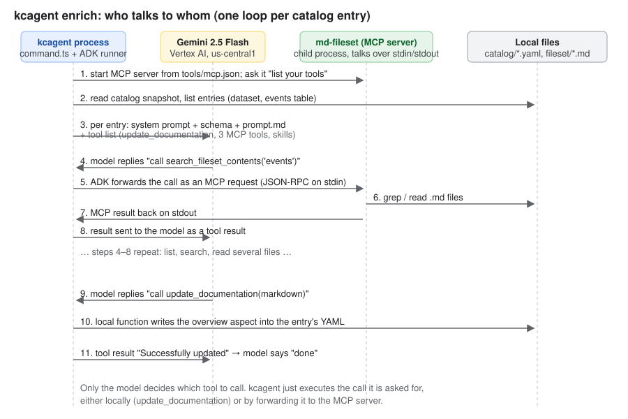

# How kcagent works (and what an MCP call is)

Source read: `GoogleCloudPlatform/knowledge-catalog` at commit `6886cc67`, folder `toolbox/enrichment/src` (725 lines of TypeScript in total).

## Tool call versus MCP call, in one line each

- **Tool call:** the model replies "please call function X with these arguments" instead of text; the program runs X and sends the result back. The model never runs anything itself.
- **MCP call:** the same thing, except X lives in **another program** (an MCP server). The agent forwards the call over a standard protocol (JSON-RPC messages, here over the child process's stdin/stdout) and relays the answer. Like calling a WCF/gRPC service instead of a local method: the model sees no difference.

## The files

| File | Lines | What it does |
|---|---|---|
| [agent/main.ts](https://github.com/GoogleCloudPlatform/knowledge-catalog/blob/6886cc67/toolbox/enrichment/src/agent/main.ts) | 37 | CLI entry point (`kcagent enrich ...`) |
| [agent/enrich/command.ts](https://github.com/GoogleCloudPlatform/knowledge-catalog/blob/6886cc67/toolbox/enrichment/src/agent/enrich/command.ts) | 140 | The loop: load tools, read the snapshot, for each entry build a prompt, run the agent, print events. Defines the **local** tool `update_documentation` |
| [agent/enrich/agent.ts](https://github.com/GoogleCloudPlatform/knowledge-catalog/blob/6886cc67/toolbox/enrichment/src/agent/enrich/agent.ts) | 108 | The system prompt ("experienced data steward…", template, workflow) and the model: `gemini-2.5-flash`, Vertex AI, thinking on |
| [agent/tools.ts](https://github.com/GoogleCloudPlatform/knowledge-catalog/blob/6886cc67/toolbox/enrichment/src/agent/tools.ts) | 92 | Reads `tools/mcp.json` and starts each MCP server (`MCPToolset`, stdio or HTTP); loads `tools/skills/*/SKILL.md` |
| [tools/md/server.ts](https://github.com/GoogleCloudPlatform/knowledge-catalog/blob/6886cc67/toolbox/enrichment/src/tools/md/server.ts) | 66 | The **MCP server**: registers 3 tools with the MCP SDK and serves them over stdio |
| [tools/md/fileset.ts](https://github.com/GoogleCloudPlatform/knowledge-catalog/blob/6886cc67/toolbox/enrichment/src/tools/md/fileset.ts) | 125 | What the 3 tools actually do: list a folder, read a file, regex-search `.md` files |

## The tools the model can call

| Tool | Kind | Defined in | Effect |
|---|---|---|---|
| `update_documentation(documentation)` | local function | command.ts | Writes the markdown into the entry's `dataplex-types.global.overview` aspect, in the local YAML. **The only write the agent can make.** |
| `list_fileset_contents(path)` | MCP | server.ts | Lists files in `fileset/` |
| `search_fileset_contents(query, path)` | MCP | server.ts | Regex search across the `.md` files, returns file, line and snippet |
| `read_fileset_file(path)` | MCP | server.ts | Returns the whole file |
| skill tools (load `fileset-source` instructions) | ADK skills | tools.ts | Gives the model the SKILL.md text on demand |

## Things worth knowing (verified by reading the code)

- **One agent run per entry.** The dataset `ga4_sample` and the table `events` each get their own conversation.
- **The prompt contains the schema as JSON** plus any existing overview, then your `prompt.md`.
- **Name mismatch:** `SKILL.md` (from Google's README) tells the model about `search_fileset_content`, but the server registers `search_fileset_contents` (with an s). The model sees the real tool list, so it usually copes.
- **Skills run with `UnsafeLocalCodeExecutor`** (tools.ts). If a skill contained code, ADK could run it on your machine without a sandbox. Our skill is text only, but a team should not point this at untrusted skill folders.
- **No connection to the catalog during the run.** It reads and writes local YAML; `kcmd push` is a separate step.
