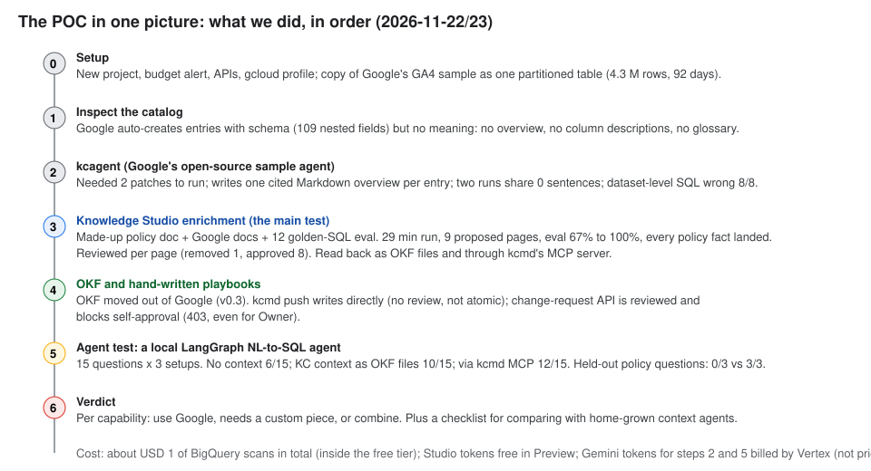

# Start here

**What this is.** A hands-on proof of concept, done in one long session on 2026-11-22/23. It tests whether Google's **Knowledge Catalog** stack can generate, review, publish and serve *context about data* to AI agents, so a team wouldn't have to build that layer itself:

- **Knowledge Catalog**: Dataplex's metadata catalog
- **Knowledge Studio**: its AI enrichment, in Preview
- **kcmd**: its "metadata as code" CLI and MCP server
- **kcagent**: Google's open-source sample agent
- **OKF**: the Open Knowledge Format

Everything ran on a copy of Google's public GA4 e-commerce sample (`bigquery-public-data.ga4_obfuscated_sample_ecommerce`), in a throwaway project. No work data and no secrets.

**Who it's for.** A person who wants the story (read top to bottom), and an AI agent that needs the facts. For the agent, [For AI agents](../AGENTS.md) has every ID, number and file in one place.

## The answer in two minutes

1. **The raw catalog knows structure, not meaning.** Google creates catalog entries for BigQuery tables automatically, with the full nested schema, but every description, key and glossary slot is empty. ([Step 1](../results/01-inspect.md))
2. **Knowledge Studio works, and you can measure it.** We gave it Google's 8 sample docs plus a *made-up* company policy full of facts that exist nowhere else ("tracer facts"), and a 12-question golden-SQL evaluation set. ([Step 3](../results/03-studio.md))
    - In 29 minutes it proposed 9 context pages.
    - **Every tracer fact landed**, each with a citation.
    - Its own evaluation rose **from 67% to 100%**.
    - The SQL it wrote changed: the partition filter went from 49% to 95% of queries, and data scanned dropped about 4×.
    - Total cost: about USD 0.41 of BigQuery, with tokens free in Preview.
3. **Review is real, but it has sharp edges.** ([Step 3](../results/03-studio.md), [Step 4](../results/04-okf.md))
    - The good parts:
        - Each page can be approved or removed on its own.
        - **An author can never approve their own change request** (403, even as project Owner).
    - The sharp edges:
        - Removing a page leaves dangling links in the index pages, and the removal isn't recorded as a rejection.
        - An 83% "High" confidence score passed a page that contradicts itself.
        - `kcmd push` **skips review entirely** and isn't atomic.
4. **Studio's output lives only in the context set.** The real BigQuery table entry still has 0 of 24 column descriptions after Studio. Studio writes *documents* (a root page, index pages, a table page and topic pages), not catalog fields. ([Step 3](../results/03-studio.md))
5. **Getting context *out* to any agent works, through OKF files.** ([Step 3](../results/03-studio.md), [Step 4](../results/04-okf.md), [Where OKF fits](context-layer.md))
    - `kcmd init --kb ... --format okf --pull` writes the published pages as plain Markdown files. The default layout pulls nothing: a 403 on Google's `document` type.
    - kcmd's local MCP server serves the same text.
    - OKF itself left Google on 2026-11-18 and is now a vendor-neutral spec (v0.3). KC's export is only loosely OKF: no titles, descriptions or trust fields, so every page looks "unverified" to an OKF reader.
6. **The context helps an agent built outside Google, on questions Studio never saw.** A local LangGraph agent answered 15 questions. With no context it got **6/15** and broke the city privacy rule twice. With the published pages as OKF files it got **10/15**, and through kcmd's MCP server **12/15** (13 and 14 when defensible readings count). It passed **3/3 held-out policy questions** where the no-context agent got 0/3, and it scanned about 3× less data. Files and MCP were equally accurate, but MCP used about 3× the tokens. ([Step 5](../results/05-agent.md); verdict per capability in [Step 6](../results/06-verdict.md))

## How to read this report

| If you want... | Read |
|---|---|
| The verdict and what to build versus use | [Step 6: verdict](../results/06-verdict.md) |
| How Studio behaves, with 30 console screenshots | [Step 3: Knowledge Studio](../results/03-studio.md) |
| Where OKF, MCP and playbooks fit with your own agents | [Where OKF fits](context-layer.md) and [Step 4](../results/04-okf.md) |
| The agent experiment and its numbers | [Step 5](../results/05-agent.md) |
| To repeat any step | the "commands" section after each step |
| What the words mean | [Concepts in plain words](concepts.md) |
| What was created in the cloud, and how to delete it | [Cloud resources](../results/cloud-resources.md) |

**Labels on every fact:** **verified** means we ran it and saw the result; **docs** means it comes from Google's documentation or a spec; **guess** means it's our reasoning and not yet checked.

**Screenshots** are inline. Click one to enlarge it. Personal details (account names, other projects) are blurred or left out.
