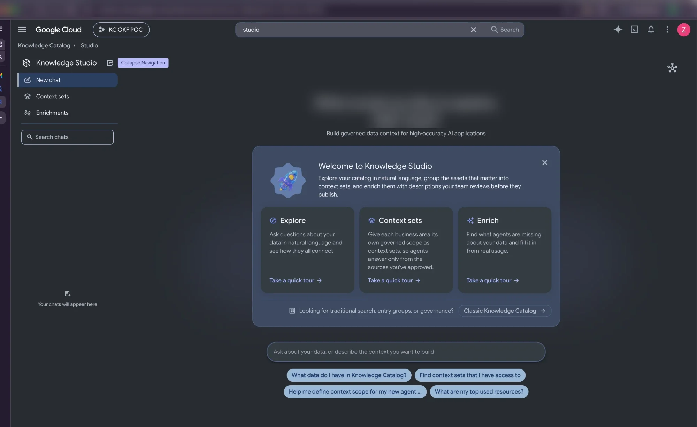
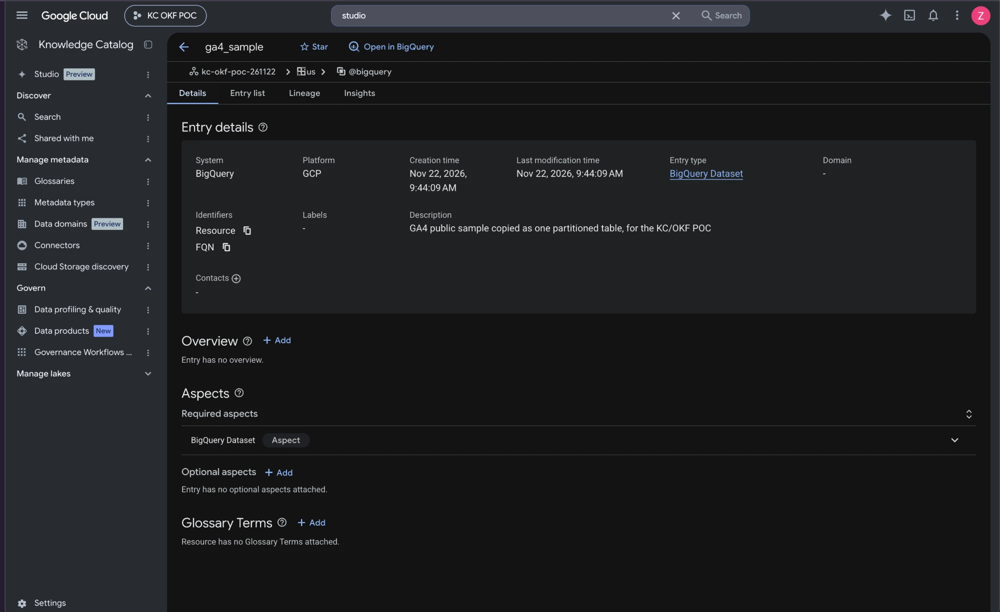
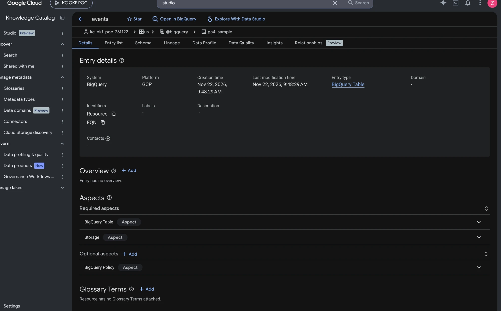
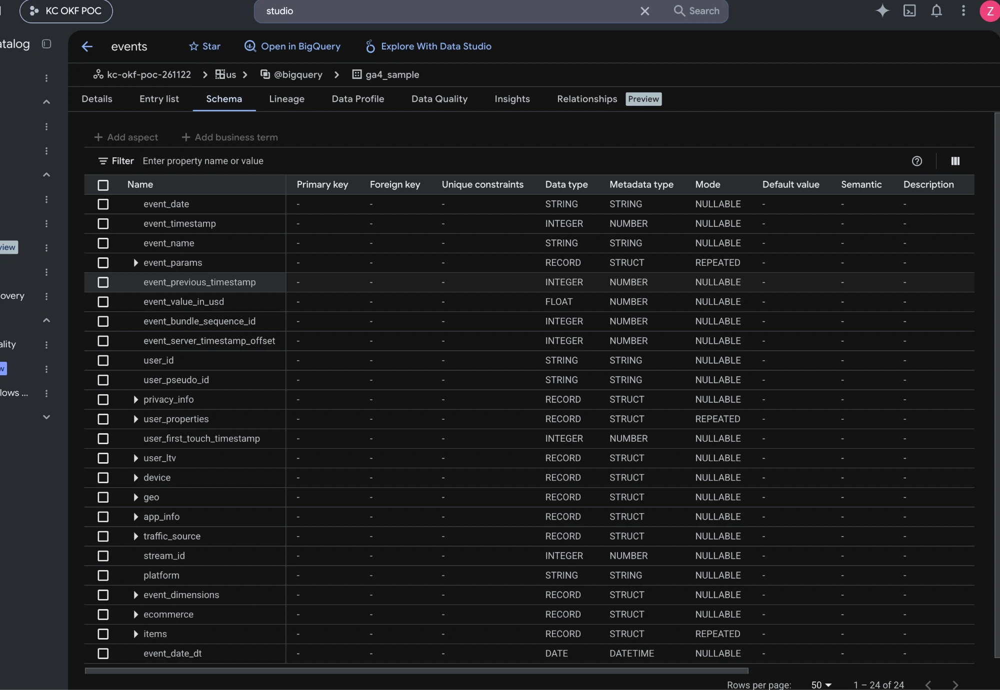
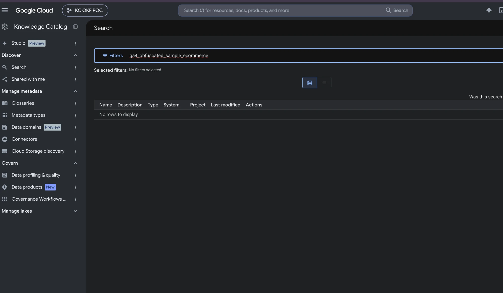

# Step 1: inspect the catalog, results

## 1a. Size of the public dataset (verified, 2026-11-22)

Free metadata query on `bigquery-public-data.ga4_obfuscated_sample_ecommerce.__TABLES__`:

| tables | first_table | last_table | total_rows | total_gb | avg_mb_per_table |
|---|---|---|---|---|---|
| 92 | events_20201101 | events_20210131 | 4,295,584 | 3.34 | 37.1 |

So copying 3 daily tables is about 110 MB: storage well under 1 cent per month.

## Why this dataset (verified, 2026-11-22, GitHub code search)

The dataset is Google's public GA4 sample (web analytics export of the Google Merchandise Store), made for GA4 and BigQuery learners, not for Knowledge Catalog. But Google's Knowledge Catalog repos use it as their standard demo dataset:

| Where | File |
|---|---|
| `kcmd` demo setup | [knowledge-catalog/toolbox/mdcode/demo/bq/setup.ts](https://github.com/GoogleCloudPlatform/knowledge-catalog/blob/main/toolbox/mdcode/demo/bq/setup.ts) |
| `kcagent` README | [knowledge-catalog/toolbox/enrichment/README.md](https://github.com/GoogleCloudPlatform/knowledge-catalog/blob/main/toolbox/enrichment/README.md) |
| Enrichment sample docs | [knowledge-catalog/samples/enrichment/sample/docs/](https://github.com/GoogleCloudPlatform/knowledge-catalog/tree/main/samples/enrichment/sample/docs) (`overview.md`, `events.md`) |
| OKF sample bundle | [open-knowledge-format/bundles/ga4/](https://github.com/GoogleCloudPlatform/open-knowledge-format/tree/main/bundles/ga4) and `samples/ga4_merch_store/` |

Both the `kcmd` demo and the `kcagent` README copy it the same way: **one table `events`, partitioned by date**, built from all 92 daily tables:

```sql
CREATE TABLE IF NOT EXISTS `<dataset>.events`
PARTITION BY event_date_dt
AS SELECT *, PARSE_DATE('%Y%m%d', event_date) AS event_date_dt
FROM `bigquery-public-data.ga4_obfuscated_sample_ecommerce.events_*`;
```

## 1b–1c. Our copy (verified, 2026-11-22)

Dataset `kc-okf-poc-261122.ga4_sample` (US), table `events` built with the query above.

| Check | Value |
|---|---|
| Rows | 4,295,584 (same as the public dataset) |
| Size | 3.62 GB (3,618,022,526 bytes; the extra date column adds a little) |
| Partitioning | DAY on `event_date_dt`, 92 distinct days |
| Schema | 24 top-level columns, 109 fields including nested ones, nested up to 3 levels (for example `items` is a repeated record) |
| Column descriptions in BigQuery | 0 of 24 |

## 1d. Console layout (verified from screenshots, 2026-11-22)

Two areas under **Knowledge Catalog** in the console:

- **Knowledge Catalog (classic)**, URL `/dataplex/dp-search`. Left menu: *Studio (Preview)*; **Discover**: Search, Shared with me; **Manage metadata**: Glossaries, Metadata types, Data domains (Preview), Connectors, Cloud Storage discovery; **Govern**: Data profiling & quality, Data products (New), Governance Workflows; **Manage lakes**. Search runs in natural-language mode by default, with a link back to keyword search, and quick filters for Datasets, Tables, Data Products, Views and Notebooks.
- **Knowledge Studio (Preview)**, URL `/dataplex/studio`. Left menu: **New chat**, **Context sets**, **Enrichments**. The welcome card reads: "Explore your catalog in natural language, group the assets that matter into context sets, and enrich them with descriptions your team reviews before they publish." Suggested prompts: "What data do I have in Knowledge Catalog?", "Find context sets that I have access to", "Help me define context scope for my new agent", "What are my top used resources?". A "Classic Knowledge Catalog" link goes back.



Two new things not in the brief: **Data products** and **Governance Workflows** in the classic menu. To check whether Governance Workflows relate to approval / separate publisher (capability 3).

## 1e. What the catalog holds before any enrichment (verified from screenshots, 2026-11-22)

Path shown in the console: `kc-okf-poc-261122 > us > @bigquery > ga4_sample > events`. Concepts: [docs/concepts.md](../docs/concepts.md).





| | Dataset entry `ga4_sample` | Table entry `events` |
|---|---|---|
| Entry type | BigQuery Dataset | BigQuery Table |
| Tabs | Details, Entry list, Lineage, Insights | Details, Entry list, Schema, Lineage, Data Profile, Data Quality, Insights, Relationships (Preview) |
| Created / modified | Nov 22 2026 9:44:09 AM (same time) | Nov 22 2026 9:48:29 AM (same time) |
| Description | "GA4 public sample copied as one partitioned table, for the KC/OKF POC" (copied from `bq mk --description`) | none |
| Labels, contacts, domain | none | none |
| Overview | "Entry has no overview" | "Entry has no overview" |
| Required aspects | BigQuery Dataset | BigQuery Table, Storage |
| Optional aspects | none | BigQuery Policy |
| Glossary terms | none | none |
| Entry list | one child: `events` (bigquery-table, no description) | — |
| Extra buttons | Open in BigQuery | Open in BigQuery, Explore With Data Studio |

**Finding:** Google created both entries automatically, within minutes, with only technical metadata. The one piece of meaning present (the dataset description) is there because we typed it into BigQuery. Business context (overview, column descriptions, terms) is empty, as expected.

**New tab to look at later:** *Relationships (Preview)* on the table entry, possibly where Studio's join proposals appear.

## 1f. Schema tab of `events` (verified from screenshot)

24 top-level rows. Columns of the grid: Name, Primary key, Foreign key, Unique constraints, Data type, Metadata type, Mode, Default value, **Semantic**, **Description**. For every row, Primary key, Foreign key, Unique constraints, Default value, Semantic and Description are all empty (`-`). Nested records (`event_params`, `user_properties`, `items` are REPEATED; `device`, `geo`, `traffic_source`, `ecommerce`, `privacy_info`, `user_ltv`, `app_info`, `event_dimensions` are single records) expand with a ▸ arrow. Buttons above the grid: **Add aspect**, **Add business term** (per column).



So the catalog already has slots for keys, a *Semantic* type and per-column descriptions; nothing fills them yet.

## 1g. Can we see Google's public tables in the catalog? (verified, CLI)

| Try | Result |
|---|---|
| Console **Knowledge Catalog > Search** for `ga4_obfuscated_sample_ecommerce`, no filters | **No rows to display** (matches the CLI result below) |
| Console top bar search | Searches Google Cloud products and **this project's** resources only ("Showing resource results for KC OKF POC only"). Not the catalog search. |
| `gcloud dataplex entries search "events"` | 1 result: our `ga4_sample.events` |
| `gcloud dataplex entries search "ga4_obfuscated_sample_ecommerce"`, with and without `--scope=projects/bigquery-public-data` | **0 results** |
| `gcloud dataplex entries lookup` by exact name, for `bigquery-public-data...events_20210131` | **Works**: full entry returned |

So public tables **have** catalog entries, readable by exact name, but **search does not find them** from our project. Saved both entries for comparison:

- [01-inspect/public-events_20210131.entry.yaml](01-inspect/public-events_20210131.entry.yaml): aspects `bigquery-policy`, `bigquery-table`, `schema`, `storage`, `usage` (empty). Catalog entry created 2024-05-25; table created 2021-08-10.
- [01-inspect/ours-events.entry.yaml](01-inspect/ours-events.entry.yaml): same aspects except `usage`.
- **Neither has a single `description:`** in its schema. Google's own public table carries no column descriptions in the catalog either.



## 1h. `kcmd` snapshot, "before" (verified, 2026-11-22)

Command (from `results/01-inspect/kcmd-before/`):
`CLOUDSDK_ACTIVE_CONFIG_NAME=kc-okf npx kcmd init --bigquery-dataset kc-okf-poc-261122.ga4_sample --pull`

Files written ([kcmd-before/](01-inspect/kcmd-before/)):

| File | Lines | Holds |
|---|---|---|
| [catalog.yaml](01-inspect/kcmd-before/catalog.yaml) | 4 | scope `bq-dataset.kc-okf-poc-261122.ga4_sample`; `snapshot.aspects: [dataplex-types.global.overview]` |
| [catalog/kc-okf-poc-261122.ga4_sample.yaml](01-inspect/kcmd-before/catalog/kc-okf-poc-261122.ga4_sample.yaml) | 14 | dataset entry: resource info, the description we typed, aspect `bigquery-dataset` |
| [catalog/kc-okf-poc-261122.ga4_sample/events.yaml](01-inspect/kcmd-before/catalog/kc-okf-poc-261122.ga4_sample/events.yaml) | 476 | table entry: aspects `bigquery-table` (partitioning by DAY on `event_date_dt`), `schema` (every field with only `name`, `dataType`, `metadataType`, `mode`), `storage` |

- **0 descriptions** in `events.yaml`. No overview aspect (it is tracked by `catalog.yaml`, but empty, so nothing is written).
- `kcmd` did **not** write the `bigquery-policy` aspect that the console and `gcloud lookup` show. It pulls the built-in structural aspects plus the ones listed in `catalog.yaml`.
- Folder layout mirrors the hierarchy: `catalog/<dataset>.yaml` for the dataset entry, `catalog/<dataset>/<table>.yaml` for its children.
- `kcmd` prints `Your active configuration is: [kc-okf]` four times: it calls `gcloud` underneath to get the project and credentials.

## Step 1 summary

The raw catalog holds **structure only**: entry types, partitioning, the nested schema tree (109 fields) and storage facts, created automatically within minutes. Every slot for meaning (overview, table and column descriptions, keys, semantic type, glossary terms, labels, contacts) is empty, both on our copy and on Google's own public table. This is the baseline for steps 2 and 3.
