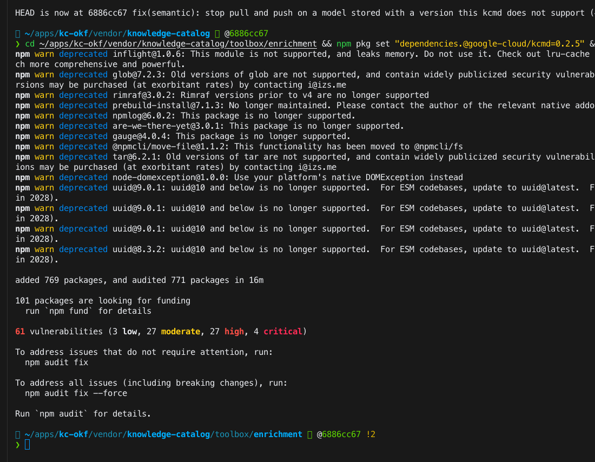
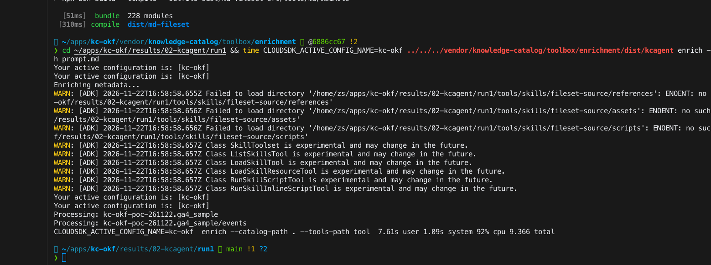
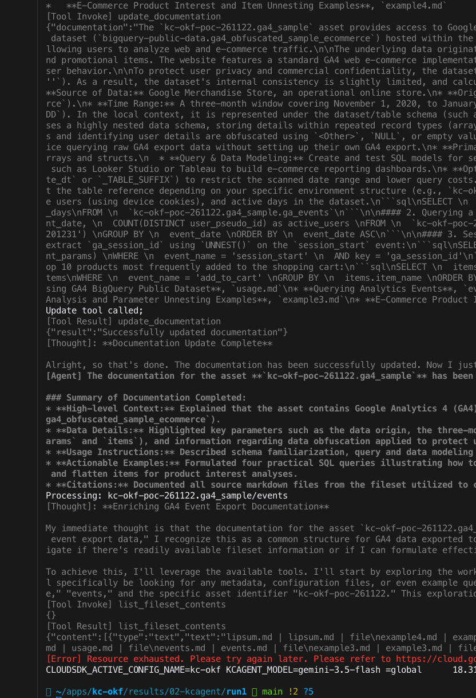
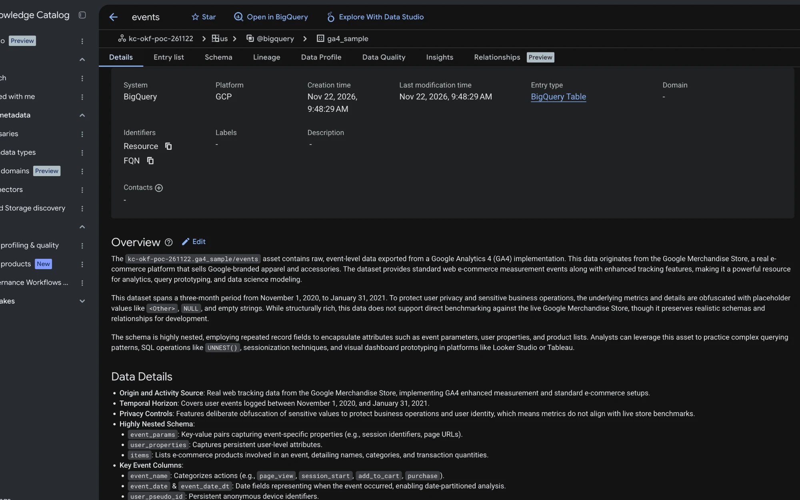

# Step 2: kcagent (Google's sample enrichment agent), results

## 2a–2b. Getting it to build (verified, 2026-11-22)

| Item | Value |
|---|---|
| Source | `GoogleCloudPlatform/knowledge-catalog` at commit `6886cc67` (2026-11-21), folder `toolbox/enrichment`, `kcagent` 0.1.0 |
| Change we made | `package.json`: `@google-cloud/kcmd` from `file:../mdcode` (unbuilt sibling folder) to the published `0.2.5` |
| Declared dependencies | runtime 4 (`@google/adk`, `@modelcontextprotocol/sdk`, `@google-cloud/kcmd`, `cac`); dev 6 (`@google/adk-devtools`, `@modelcontextprotocol/inspector`, `@types/node`, `bun` 1.3.14, `bun-types`, `typescript`) |
| `npm install` | **769 packages, 891 MB, 16 minutes** on a home connection |
| Largest parts | bun binaries (`@oven`) 346 MB, `googleapis` 112 MB, `@opentelemetry` 62 MB, debug-UI packages (`@azure`, `lucide-react`, …) ~100 MB, `typescript` 24 MB |
| `npm audit` (all) | 61: 3 low, 27 moderate, 27 high, **4 critical** (`concurrently`, `proxy-addr`, `shell-quote`, `tar`) |
| `npm audit --omit=dev` (runtime only) | 54: 3 low, 27 moderate, 22 high, **2 critical**: `proxy-addr` (IP spoofing in a web-server helper) and `tar` (path traversal when unpacking archives) |

**Reading:** most of the download is build tooling and debug UIs, not the agent. Run on a laptop as a CLI, neither critical advisory is reachable in our use (we run no web server and unpack no untrusted archives). We did **not** run `npm audit fix`, to keep Google's lock file as shipped. For a team, this is a demo dependency tree, not something to deploy as is.

### Build gotcha (verified)

Changing `package.json` alone was **not enough**: Google's `package-lock.json` still said `resolved: ../mdcode, link: true`, and `../mdcode/package.json` is also version 0.2.5, so `npm install` kept a symlink to the **unbuilt** source folder. TypeScript compiled (it reads source types), then `bun build` failed with `Could not resolve: "@google-cloud/kcmd"`. Fix: move the symlink aside and run `npm install --save-exact @google-cloud/kcmd@0.2.5`, which downloads the published package and rewrites the lock entry.

### Build output (verified)

| File | Size | Built by |
|---|---|---|
| `dist/kcagent` | 121 MB | `bun build --compile` (bun 1.3.14), standalone, no `node_modules` needed at run time |
| `dist/md-fileset` | 92 MB | same; a small MCP server with tools `list_fileset_contents`, `read_fileset_file`, `search_fileset_content` |

- Even `kcagent --help` **fails at start** if gcloud has no `compute/region`: it runs `gcloud config get-value project`, `... compute/region` and `gcloud auth application-default print-access-token` before parsing arguments.
- Model is hard-coded: `gemini-2.5-flash` on **Vertex AI**, project and location taken from those gcloud values (so `us-central1` in our `kc-okf` profile), with thinking enabled ([agent.ts](https://github.com/GoogleCloudPlatform/knowledge-catalog/blob/6886cc67/toolbox/enrichment/src/agent/enrich/agent.ts)).

## 2c. Run inputs (committed before running, so `git diff` shows exactly what the agent changed)

[run1/](02-kcagent/run1/) and [run2/](02-kcagent/run2/) are identical:

- `catalog.yaml` + `catalog/`: copy of the step 1 "before" snapshot
- `fileset/`: Google's 8 sample docs, unchanged ([source](https://github.com/GoogleCloudPlatform/knowledge-catalog/tree/6886cc67/samples/enrichment/sample/docs)). They name the table `kc_enrich_sample_data.ga_events`, not our `ga4_sample.events`.
- `prompt.md`, `tools/mcp.json`, `tools/skills/fileset-source/SKILL.md`: copied from Google's README demo; only the `md-fileset` path changed to point at our build

## 2d. First run attempts: silent failure, then model not available (verified)

1. **Run 1, attempt 1:** finished in 9 s, printed `Processing:` for both entries, **no output and no file changes**. Cause: Google's loop in `command.ts` prints thought, content, tool-call and tool-result events but **ignores ADK `ERROR` events**, so failures are silent. *POC patch 1:* 4 lines that print `ERROR` events.
   

2. **Attempt 2** then showed, for both entries: `Publisher model projects/kc-okf-poc-261122/locations/us-central1/publishers/google/models/gemini-2.5-flash was not found or your project does not have access to it.`
3. **Direct test calls** (one-word prompt each) on Vertex `generateContent`:

| Model | `global` | `us-central1` |
|---|---|---|
| `gemini-2.5-flash` (kcagent's hard-coded model) | 404 not found / no access | 404 not found / no access |
| `gemini-3.5-flash` | **200 OK** | 404 not found / no access |

The model *catalog* lists `gemini-2.5-flash` as GA, yet this **new** project cannot call it in either location. So the demo, as shipped, does not run in a project created today. *POC patch 2:* `agent.ts` reads `KCAGENT_MODEL` and `KCAGENT_LOCATION` from the environment (defaults unchanged). Runs below use `gemini-3.5-flash` on `global`.

Both patches live only in the `vendor/` checkout; the full diff is in [02-kcagent/vendor-patch.diff](02-kcagent/vendor-patch.diff).

(Side note for anyone repeating this in zsh: `$m:generateContent` in a URL is read as a zsh history modifier; write `${m}:generateContent`.)

## 2e. Rate limit on a new project (verified)

Attempt 3 (gemini-3.5-flash, global): the **dataset** entry was enriched (175 lines of overview added, all 8 sources searched and cited, 4 SQL examples). On the **table** entry, after the first tool call: `[Error] Resource exhausted. Please try again later.` (HTTP 429, Vertex quota). kcagent has **no retry**; the run ended with only one of two entries done. The partial result is kept as [attempts/run1-attempt3-partial-429.diff](02-kcagent/attempts/run1-attempt3-partial-429.diff), and `run1/` was reset to the clean input so each real run is complete and comparable.

## 2f. Run 1, complete (verified, 2026-11-22)

Command: see [poc/02-kcagent](../poc/02-kcagent/README.md), with `KCAGENT_MODEL=gemini-3.5-flash KCAGENT_LOCATION=global`. Both entries got an overview; nothing else in the YAML changed.

| Entry | Overview | Words |
|---|---|---|
| `ga4_sample` (dataset) | 89 lines | 554 |
| `events` (table) | 98 lines | 683 |

First checks on the `events` overview:

- Follows the system prompt's template: summary paragraphs, *Data Details*, *Usage Details*, *Citations*.
- **Cites 7 of 8 docs** and **ignores `lipsum.md`** (the noise file).
- **Mapped the docs' table name to ours:** every SQL `FROM` uses `kc-okf-poc-261122.ga4_sample.events`; the docs' name `kc_enrich_sample_data.ga_events` does not appear.
- Advice to filter on the partition column `event_date_dt` is grounded: partitioning comes from the schema aspect, date filtering from `example2.md` and `overview.md`.

## 2g. Run 2 and comparison (verified, 2026-11-22)

Same inputs, same model (`gemini-3.5-flash`, global), separate folder. Both entries enriched, no errors.

| | Run 1 | Run 2 |
|---|---|---|
| Dataset overview | 89 lines, 554 words | 91 lines, 637 words |
| Table overview | 98 lines, 683 words | 90 lines, 575 words |
| Template sections | same 4 (summary, Data Details, Usage Details, Citations) | same 4 |
| Sub-headings | dataset: 4 numbered query headings; table: 4 numbered query headings | dataset: 4, differently worded; table: **none** (one "SQL Query Examples" block) |
| Citations | the same 7 docs | the same 7 docs |
| `lipsum.md` used | no | no |
| SQL examples | 4 per entry | 4 per entry |

**Text similarity between runs:** about 40 % of words in the same order (0.39 dataset, 0.41 table) and **0 identical sentences** (dataset 0 of 23 vs 22; table 0 of 29 vs 22). The *structure and sources* are stable; the *wording* is entirely new each time. Smaller spread than the earlier work-machine runs with `gemini-2.5-flash` (120 vs 65 lines), but different model and inputs, so not directly comparable.

### Are the SQL examples correct? (BigQuery dry run, free, [sql-check/](02-kcagent/sql-check/))

| Overview | Queries | Valid | Bytes each would scan |
|---|---|---|---|
| `events` table, run 1 | 4 | **4** | 126 MB, 60 MB, **864 MB**, 161 MB |
| `events` table, run 2 | 4 | **4** | same four numbers |
| `ga4_sample` dataset, run 1 | 4 | **0** | — |
| `ga4_sample` dataset, run 2 | 4 | **0** | — |

- **All 8 queries in the dataset overviews are invalid**, in both runs: they query `` FROM `kc-okf-poc-261122.ga4_sample` ``, which is the dataset, not a table (`Not found: Dataset kc-okf-poc-261122:kc-okf-poc-261122`). The agent copied the asset name it was given into a table position. Nothing in kcagent checks generated SQL.
- The table overviews' SQL is valid, and both runs produced the **same four queries** (same bytes scanned), adapted from `example1–4.md`.
- Both table overviews advise "always filter on `event_date_dt`", yet only query 2 does; query 3 scans 864 MB (the whole table). The advice and the examples disagree.

### Step 2 summary

kcagent writes **one thing**, a markdown overview per entry, grounded in the docs it was given and with citations at file level (not per statement). Structure and sources repeat between runs; wording does not. Its SQL examples are only as good as its asset name handling: valid for the table, invalid for the dataset in every case. To run at all in a new project it needed three fixes (published `kcmd`, error printing, a model that the project can call) and a retry after a 429.

## 2h. Push run 1 to the catalog

- Run 2 took **2 min 23 s** wall-clock (21.9 s CPU); almost all of it is waiting on the model.
- `kcmd push --dry-run` printed only `Validating catalog entries...` / `Validation complete; no changes applied.` It **does not list what would change**, so the dry run is a validity check, not a preview. The local `git diff` is the real preview.
- From `kcmd`'s code (`cli.js`, `applyChunk` / `applyViaEntries`): a push sends one `batchChangeMetadata` request (falling back to per-entry `modifyEntry`) with an **update mask and aspect keys**, so only the listed aspects (here `overview`) are written. After a push it also sets a push-state **label** on the entry.

**Push result (verified, 2026-11-22 18:01 UTC):** `kcmd push` succeeded. The `events` entry page now shows run 1's text under **Overview** (rendered markdown, with an **Edit** button). Read back with `gcloud dataplex entries lookup --view=ALL`:

- overview aspect created at `18:01:39`, 5,418 characters
- the entry's own `updateTime` moved to `18:01:39`, but the console's **"Last modification time" still shows 9:48:29 AM**: that field is the BigQuery source's time (`entrySource.updateTime`), not the catalog edit time
- **no labels** were added (the push-state label in the code applies to OKF-style pushes, not to BigQuery entries)
- the console gives no hint of who or what wrote the overview, nor of the citations' trust level: it looks the same as a human-written one
