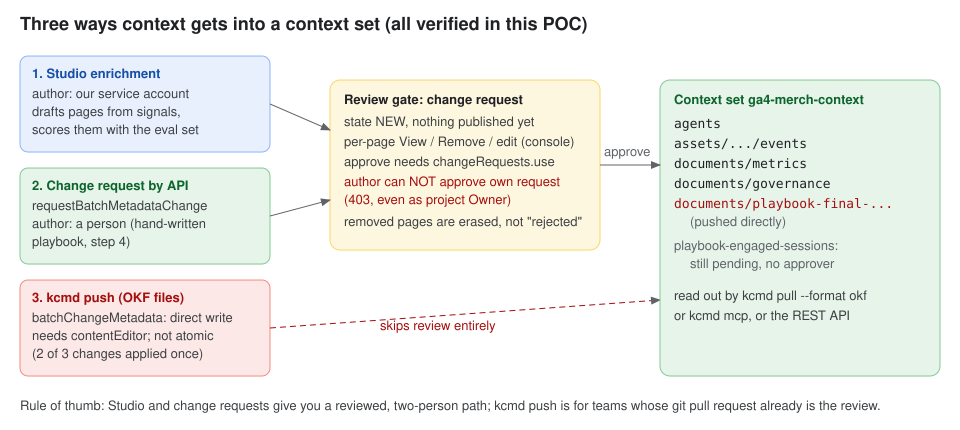

# Step 4: OKF, hand-written playbooks and the two ways to write context

**What this step answers:** what OKF is today, how close Knowledge Catalog's export is to it, and how a team gets its own *process* knowledge (playbooks) into a context set, with or without review. Commands: [poc/04-okf/README.md](../poc/04-okf/README.md). Background: [docs/context-layer.md](../docs/context-layer.md).

Run on 2026-11-22/23 (UTC). Labels: **verified** = we ran it; **docs** = Google's spec or README; **guess** = not checked.

## Summary

| Question | Answer |
|---|---|
| Is OKF still Google's project? | **No.** On 2026-11-18 Google marked `GoogleCloudPlatform/open-knowledge-format` deprecated. OKF now lives at `open-knowledge-format/open-knowledge-format`, spec **v0.3**. **verified** |
| Does Knowledge Catalog's export follow OKF? | **Loosely.** Every file has valid frontmatter with a `type`, so the bundle is conformant by §11.1. But it uses none of OKF's richer fields: no `title`, `description`, `generated`, `verified` or `sources`, no `index.md`, and numbered `[n]` citations instead of footnotes. Google's own OKF sample bundle uses all of them. **verified** |
| Can a team write context by hand and push it? | **Yes, with `kcmd push`, and it is NOT reviewed.** It writes directly (`batchChangeMetadata`); no change request is created. **verified** |
| Is there a reviewed route for hand-written context? | **Yes, by API.** `entryGroups:requestBatchMetadataChange` creates a change request in state NEW; nothing is published until someone approves it. **verified** |
| Can the author approve their own change request? | **No.** The API returns `403 "User is not authorized to approve their own ChangeRequest"`, even for a project Owner. **verified** |
| Are playbooks a first-class idea? | **In OKF, yes**: the spec's own example is `type: Playbook` with `# Trigger` / `# Steps` (§4.4). **docs**. In Knowledge Catalog a playbook is just another `document` page; there's no special type or behaviour. **verified** |

## 4a. What OKF is (and the deprecation)

- **OKF = Open Knowledge Format**: "a universal, vendor-neutral format for representing knowledge as plain markdown files with YAML frontmatter", organised in folders, with `index.md` files for progressive disclosure. **docs**
- The old repo (`GoogleCloudPlatform/open-knowledge-format`, v0.2 spec, a Google ADK reference agent and sample bundles, including one for GA4) is **deprecated** as of 2026-11-18 (commit `8a8ff87`, "Mark the repository as deprecated"). The README points to `open-knowledge-format/open-knowledge-format` (commit `527e81a`, same date) with spec **v0.3**, bundles, and two agent skills: `okf-consume` and `okf-generate`. **verified** (both cloned into `vendor/`, git-ignored)
- What the v0.3 spec adds beyond "Markdown with frontmatter": **docs**
    - only `type` is required; `title`, `description`, `resource` and `tags` are optional
    - **provenance**: `sources` (with id, author, usage count, last modified) and per-claim footnotes `[^id]`
    - **trust**: `generated: {by, at}` and `verified: [{by, at}]`, giving trust tiers *unverified* → *machine-confirmed* → *human-reviewed* (a human check older than the last rewrite doesn't count)
    - **lifecycle**: `status` (draft/stable/deprecated), `superseded_by` and `stale_after`
    - **attested computations**: a sanctioned query a consumer must run as given, not rewrite
    - reserved `index.md` (directory listing; the root one can carry `okf_version`, `title`, `description`, `license`) and `log.md`
    - extension keys must start with `x-<producer>-`

## 4b. Knowledge Catalog's export versus OKF v0.3

`uv run tools/okf_check.py <bundle>` on our pulled context set and on the GA4 bundle in Google's OKF repo. Full tables: [04-okf/okf-check-kc-bundle.md](04-okf/okf-check-kc-bundle.md), [04-okf/okf-check-google-ga4-bundle.md](04-okf/okf-check-google-ga4-bundle.md). **verified**

| | KC context set via `kcmd --format okf` | Google's OKF GA4 sample bundle |
|---|---|---|
| Frontmatter parses, `type` present | 8/8 | 9/9 concepts |
| `type` values | `context-set`, `knowledge-base-index`, `knowledge-base`, `table-context` | `BigQuery Dataset`, `BigQuery Table`, `Reference` |
| `title` / `description` | 0/8 | 9/9 |
| Trust (`generated`, `verified`, `sources`) | 0/8 (the Studio job is kept in `x-kcmd`) | `generated` + `sources` on 9/9 |
| Folder index files | `documents.md` *next to* `documents/` (a concept, `type: knowledge-base-index`) | `documents/index.md` style (reserved, no frontmatter) |
| Root | `agents.md`; no `index.md`, no `okf_version` | `index.md` with `okf_version: "0.3"` |
| Citations | numbered `[1]` plus a "Source References" list (§4.2 says not to do this) | footnotes `[^id]` joined to `sources` |
| Extension keys | `x-kcmd` (the spec's convention is `x-<producer>-<name>`) | none |

**What this means:** a generic OKF consumer (for example the `okf-consume` skill) can *read* KC's export, but it gets no titles or descriptions to scan, and **every page shows as "unverified"**. That holds even though a human approved each one in Studio, because the approval isn't written into the file as `verified`. The review happened, but the exported files don't record it. **verified** (fields absent) / impact on consumers is **docs** (§5.3)

## 4c. Write path 1: `kcmd push` (direct, unreviewed)

The workspace was a copy of the step 3 pull. We added a hand-written playbook, [`documents/playbook-final-daily-net-revenue.md`](04-okf/workspace/bundle/documents/playbook-final-daily-net-revenue.md) (when to use, approach, SQL, traps; based on eval question 12), and edited the `documents.md` index to replace the dangling `pitfalls` row with the playbook.

1. **Dry run:** `3 change(s): 1 create, 2 update, 0 delete, 5 unchanged`. It also planned to write `agents.md`, which we hadn't changed. [04-okf/push-dry-run.txt](04-okf/push-dry-run.txt) **verified**
2. **First push was partial:** `documents/playbook-...: Missing required Aspect(s): .../aspectTypes/document` then "Pushed 2/3 change(s)". The index update was applied, but the page it points to wasn't. **The push isn't atomic**, so for a short time the published index linked to a missing page. [04-okf/push.txt](04-okf/push.txt) **verified**
3. **Fix:** a hand-written page needs `x-kcmd.aspects: {dataplex-types.global.document: {}}` in its frontmatter; Google's `document` entry type requires that aspect. Second push: "Pushed 1/1 change(s)". [04-okf/push-2.txt](04-okf/push-2.txt) **verified**
4. **No review:** the change request list was the same before and after (only Studio's `345f4080`, APPROVED). Anyone with `dataplex.contentEditor` on the context set can change what agents read, without review. **verified**
5. **Round trip:** a fresh `kcmd init --kb ... --format okf --pull` into [04-okf/pull-after-push/](04-okf/pull-after-push/) wrote 8 concepts. The playbook body came back byte-identical. The only other difference: the root `agents.md` now says `type: context-set` (it was `knowledge-base-root`). **verified** Why is a **guess**: in step 3, kcmd's MCP server already reported the root's document type as `context-set` while the file said `knowledge-base-root`, so kcmd seems to map the root's role and the push wrote that mapping back.

## 4d. Write path 2: change request by API (reviewed)

A second playbook, *count engaged sessions* (the correct session key, the three engagement rules, golden SQL 11), submitted as a change request. Request body: [04-okf/reviewed-route/request.json](04-okf/reviewed-route/request.json).

- `POST .../entryGroups/ga4-merch-context:requestBatchMetadataChange` returned change request `919699e7-...`: `state: NEW`, `author` = the user, `labels: {source: human}`. **verified**
- **The entry doesn't exist until approval** (`GET` returns 404). **verified**
- **Approving it ourselves:** `POST .../changeRequests/919699e7-...:approve` returned **403 PERMISSION_DENIED: "User is not authorized to approve their own ChangeRequest"**. The caller is project Owner, so the rule doesn't depend on roles: **an author can never approve their own change**. (Studio's change request was authored by the service account, which is why the user could approve it in step 3.) **verified**
- We left it **pending (NEW)**. The user chose not to set up a second account, so this playbook isn't published and isn't used in step 5. It's listed in [cloud-resources.md](cloud-resources.md).

## 4e. Where this leaves process context (playbooks)

- **Format:** OKF already has the right shape: `type: Playbook`, `# Trigger`, `# Steps`, with `generated`/`verified` for trust. Knowledge Catalog stores a playbook as a `document` page and keeps no playbook-specific fields. **docs** / **verified**
- **Writing them:** choose deliberately between the two routes:
    - `kcmd push` is fast, git-friendly and **unreviewed**. It's fine if git pull requests are your review.
    - A change request gives a **review gate** where the author can't approve their own change. It has no CLI in kcmd 0.2.5; it's a raw API call.
- **Studio as the writer:** Studio can also *draft* playbook-like pages (step 3's `computing-standard-ecommerce-metrics`), but it rewrites its inputs. Exact SQL that a team trusts is safer written by hand.
