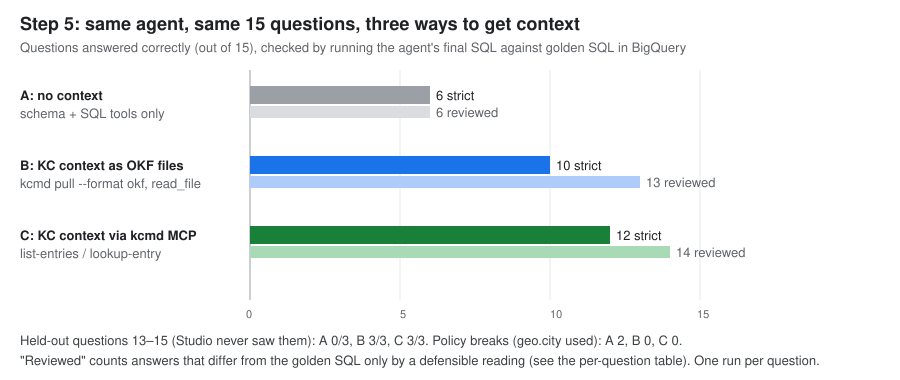

# Step 5: does the published context help a real agent?

**What this step answers:** take the context Studio produced and we approved (plus one hand-written playbook), give it to an ordinary agent built **outside Google**, and measure whether it answers data questions better. We also compare the two ways an outside agent can read the context: **OKF files** and **kcmd's MCP server**. Commands and code: [poc/05-agent/README.md](../poc/05-agent/README.md).

Run on 2026-11-23 (UTC). Everything here is **verified** unless marked.

## Setup

- **Agent:** a LangGraph ReAct agent (`create_react_agent`) on **Gemini 3.5 Flash** (Vertex AI, `global`, temperature 0). The instructions are identical in every setup: answer about the `events` table, check your result, and end with the final SQL. The only difference between setups is the context tools.

| Setup | Tools | What it can read |
|---|---|---|
| **A: no context** | `get_table_schema`, `run_sql` | column names and types only |
| **B: OKF files** | A + `list_files`, `read_file` | the published context set, pulled with `kcmd init --kb ... --format okf --pull`: 8 pages (Studio's 7 plus our playbook) |
| **C: kcmd MCP** | A + `list-entries`, `lookup-entry` from `kcmd mcp` (`modify-entry` removed) | the same 8 pages, served as JSON over MCP |

- **Questions:** 15 ([questions.json](../poc/05-agent/questions.json)). Questions 1–12 are Studio's evaluation set, so Studio tuned its pages on them. **Questions 13–15 are held out**: Studio never saw them. Each one needs a policy rule: exclude `(data deleted)` from attribution; cities are Tier C3, so report regions; and only final days, net of refunds.
- **Scoring** ([score.py](../poc/05-agent/score.py)): run the agent's final SQL and the golden SQL in BigQuery and compare the result sets (numbers within 0.5%). Other equally valid readings of a question count as alternates. A SQL that uses `geo.city`/`geo.metro` where the policy forbids it fails. No final SQL fails.
- **One run per question per setup** (45 runs). The user chose the smaller run to keep cost down. Gemini still varies at temperature 0, so a difference of one or two questions is within noise.

## Results

| Setup | Strict pass | Reviewed pass | Held-out 13–15 | Uses partition filter | Broke the city rule | GB scanned | Avg tool calls | Input / output tokens (all 15) |
|---|---|---|---|---|---|---|---|---|
| A: no context | **6/15** | 6/15 | **0/3** | 9/15 | 2 | 44.9 | 12.7 | 1.0 M / 0.2 M |
| B: OKF files | **10/15** | 13/15 | **3/3** | 14/15 | 0 | 16.6 | 17.5 | 2.3 M / 0.3 M |
| C: kcmd MCP | **12/15** | 14/15 | **3/3** | 15/15 | 0 | 14.9 | 12.5 | 6.4 M / 1.0 M |

"Reviewed" counts answers that differ from the golden SQL only by a defensible reading. A person checked every failure; see the table below. Full per-run data: [05-agent/scores.csv](05-agent/scores.csv), [05-agent/summary.md](05-agent/summary.md), raw runs (answers, SQL, tool calls) in `05-agent/runs-*.jsonl`.

### Per question

| Q | Question | A: no context | B: OKF files | C: kcmd MCP |
|---|---|---|---|---|
| 1 | Total sessions | ✅ | ✅ | ✅ |
| 2 | Daily active users, Dec 2020 | ✅ | ❌ ran out of steps (no final answer) | ✅ |
| 3 | Top 10 products added to cart | ✅ | ❌ (reviewed: ✅) grouped by name **and** item ID | ✅ |
| 4 | Top pages on 15 Jan 2021 | ✅ | ❌ (reviewed: ✅) page path instead of full URL | ❌ (reviewed: ✅) page path instead of full URL |
| 5 | Purchases per day, 1–7 Jan 2021 | ✅ | ✅ | ✅ |
| 6 | Net merch revenue, Dec 2020 | ❌ ran out of steps | ✅ | ✅ |
| 7 | Active buyers (28d) | ✅ | ✅ | ✅ |
| 8 | Users "by city", Jan 2021 | ❌ **grouped by `geo.city`** (policy broken) | ❌ right rule (regions) but only the top 10 rows | ✅ |
| 9 | Sessions by source, for attribution | ❌ didn't exclude `(data deleted)` | ❌ (reviewed: ✅) excluded it, also split by medium and dropped the last 3 days (the finality rule) | ❌ (reviewed: ✅) same as B |
| 10 | Cart conversion rate, Dec 2020 | ❌ events, not sessions | ✅ | ✅ |
| 11 | Engaged sessions, Jan 2021 | ❌ GA4's own definition | ✅ | ❌ used GA4's `session_engaged` flag, not the policy's definition |
| 12 | Daily net revenue, final days only | ❌ ran out of steps | ✅ (read the playbook) | ✅ |
| 13* | Sessions by medium, for attribution | ❌ didn't exclude `(data deleted)` | ✅ | ✅ |
| 14* | Top 5 **cities** by purchasers | ❌ **grouped by `geo.city`** (policy broken) | ✅ regions, and said why | ✅ |
| 15* | Net revenue, Jan 2021, final days only | ❌ ran out of steps | ✅ $57,001 | ✅ $57,001 |

\* held out: not in Studio's eval set.

## What we learned

1. **The context works for an outside agent, including on questions Studio never saw.** With the published pages, the same agent went from 6/15 to 10–12/15 (strict) and from **0/3 to 3/3 on the held-out policy questions**. It followed rules that exist *only* in our made-up policy:
    - it refused city-level output
    - it excluded `(data deleted)` from attribution
    - it dropped the 3 non-final days
    - it subtracted refunds

    Without context it broke the city rule twice and never applied the others.
2. **The answers explain the policy, which is what you want from a governed agent.** For "top 5 cities", setup B answered: "geographic fields such as `geo.city` and `geo.metro` are classified as Tier C3 (Restricted). They must never be displayed directly at the city level ... this policy changes the question", and then returned regions. For December net revenue, both B and C gave $160,555 and noted the attribution-filtered figure separately.
3. **Context makes queries cheaper.** The partition filter went from 9/15 to 14–15/15, and BigQuery bytes scanned fell from 44.9 GB to about 15–17 GB (about 3× less), matching what Studio's own logs showed in step 3.
4. **The agents read the pages the way the root page tells them to.** Both setups opened the root (`agents`) first in all 15 runs, then the two topic pages, and **the hand-written playbook in 12–14 of 15 runs**. The `events` table page was read less often (6 runs over MCP, 11 as files). The index-then-pages navigation works.
5. **OKF files and MCP give the same knowledge; the difference is cost.** Their pass rates are within noise of each other (10 vs 12 strict, 13 vs 14 reviewed). But **MCP used about 3× the input tokens and 3.5× the output tokens**: 6.4 M vs 2.3 M in, and about 190 s vs 92 s per question. `lookup-entry` returns each page as a JSON document (escaped Markdown inside an aspect), and the agent's history grows with it. The files route is simpler and cheaper, which supports the recommendation in [Where OKF fits](../docs/context-layer.md).
6. **What context didn't fix:**
    - An agent can still prefer its own knowledge over the policy. C used GA4's built-in `session_engaged` flag for "engaged sessions" (Q11), although the policy defines it differently. Golden SQL questions like this are what catch it.
    - Long context makes the agent slower and can exhaust its step budget (B, Q2).
7. **Failure modes with no context were silent.** Four of A's runs ended in "Sorry, need more steps" after the model kept second-guessing itself. On Q15 it guessed what "final days" meant and never settled. A team building an agent without a context layer would see this as flakiness.

## Caveats

- **One run per question per setup.** Treat B vs C as a tie; treat "with context" vs "without context" as a clear difference (the gap is large and consistent across questions, especially the held-out ones).
- **Questions 1–12 were Studio's own eval set**, so its pages are tuned to them. The held-out questions 13–15 are the fair check; all three need the policy, and both context setups passed all three.
- **The scorer is strict by design.** Golden SQL encodes one reading of each question; the reviewed column shows where a person would accept another reading. The rules are in [score.py](../poc/05-agent/score.py) and the alternates are in [questions.json](../poc/05-agent/questions.json).
- **Throughput was limited by Vertex quota** on this new project. The three setups ran in parallel and often hit 429s, which were retried with back-off. That's why the 45 runs took about 2.5 hours; the per-run times above exclude the waits.
- **Cost:** about 76 GB of BigQuery scans (about USD 0.48 on-demand, inside the free tier) plus about 10 M Gemini 3.5 Flash input tokens and 1.4 M output tokens. Check the Vertex price list for Gemini; we didn't look up the price.
