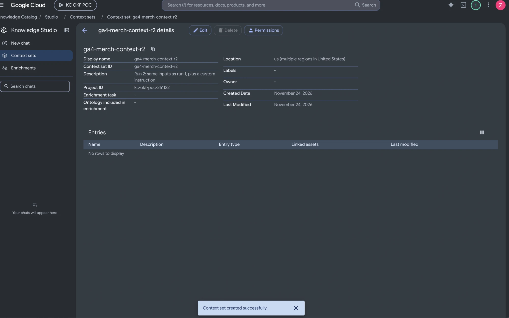
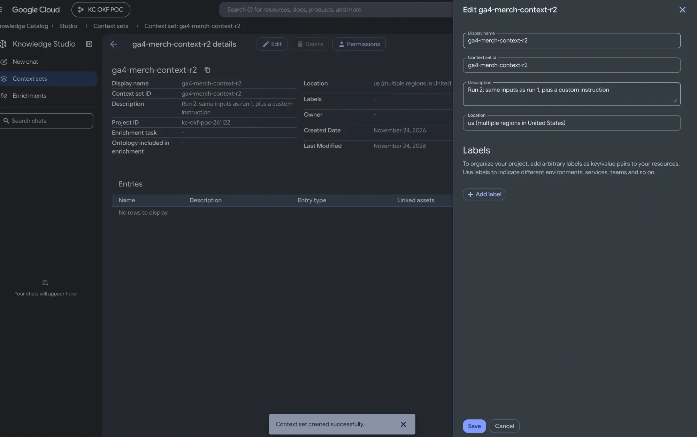
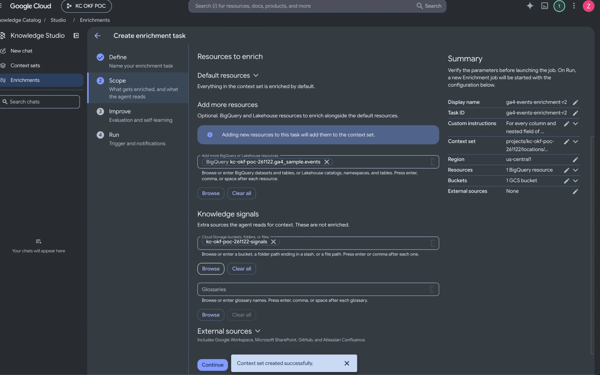
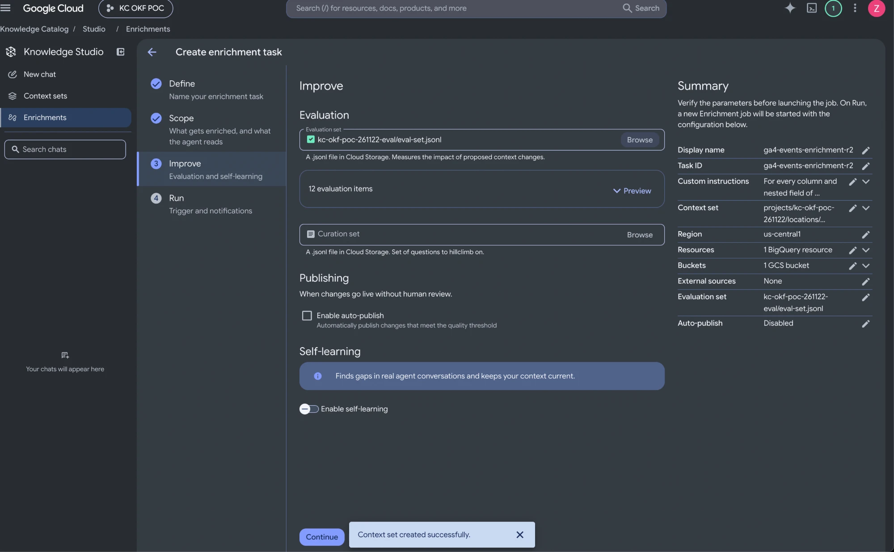
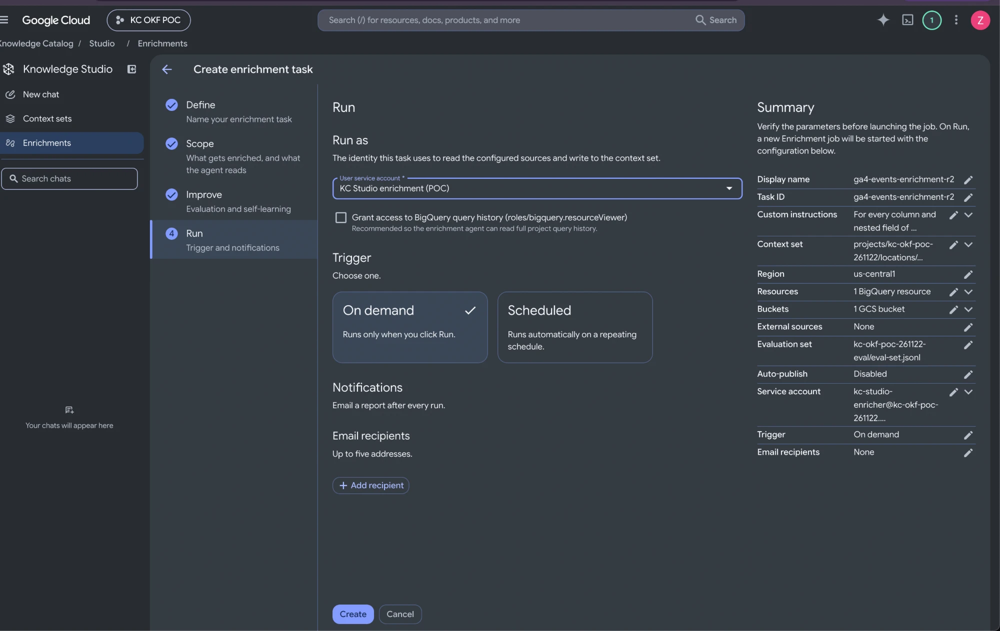
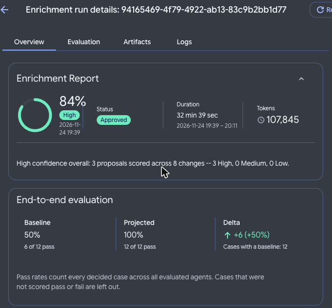
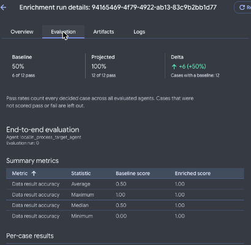

# Step 7: Studio run 2, same inputs plus one custom instruction

**The question:** in run 1, Studio wrote prose pages only: no column description fields, no sensitivity or personal-data flags, no glossary terms, no separate rules. An in-house tool given the same schema and documents produces all of those, because its prompts ask for them. **Is the gap the product, or just the missing instruction?** Run 2 changes exactly one thing, the task's custom instruction, and measures the same things as run 1.

Run on 2026-11-24 (UTC). Labels: **verified** (run and observed), **docs** (from Google's documentation), **guess** (not checked).

## Run 1 vs run 2 at a glance

| Measure | Run 1 (no instruction) | Run 2 (with instruction) |
|---|---|---|
| Column descriptions as **catalog fields** (`schema` aspect in the context set, or the BigQuery entry) | 0 of 24 columns, 0 of 109 fields | **0 of 24, 0 of 109** (no `schema` aspect proposed) |
| Columns described **in prose** (table page) | 12 of 24 | **24 of 24** |
| Nested fields described in prose (85) | 0 | 4 (`geo.city`, `geo.metro`, `ecommerce.purchase_revenue_in_usd`, `ecommerce.refund_value_in_usd`) |
| Sensitivity tier per column | only on a separate policy page, by group | inline for 5 columns; **wrong for the other 19** on the table page ("no assigned policy tier"; the policy says C1) |
| Personal-data flag | none | prose, 5 columns (C2 personal, C3 "quasi-identifying personal", C1 "non-personal") |
| **Glossary terms** (Knowledge Catalog objects) | 0 | **0** (no glossary created in `us` or `global`) |
| Glossary terms in prose | 4 metric definitions | a "Business Glossary & Metric Definitions" section: 5 terms, all correct |
| Data rules | folded into "How to query" bullets | **8 numbered rules** in a Governance section (still prose, not separate items) |
| 14 planted policy facts | 14/14 | 14/14 |
| Description accuracy, 30 fixed fields | 1 right, 1 vague, 0 wrong, 28 not described | 4 right, 4 vague, 0 wrong, 22 not described |
| Proposals | 9 creates (8 pages + 1 link), 4 scored High | 8 creates (7 pages + 1 link), 3 scored High |
| Run time / tokens | 29 min 12 s / 104,025 | 32 min 39 s / 107,845 |
| BigQuery | 209 jobs, 65.2 GB, about USD 0.41 | 217 jobs, 63.9 GB, about USD 0.40 |
| Studio eval (baseline → projected) | 67% (8/12) → 100% | 50% (6/12) → 100% |
| Confidence (Studio's own) | 83–87%, High | 84% overall; events 84, pitfalls 86, metrics 87 |
| Agent test, strict (of 15): files / MCP | B 10 / C 12 (Studio's pages + our playbook) | **B2 12 / C2 12** (Studio's pages only) |
| Agent test, reviewed / held-out 13–15 | 13, 14 / 3/3, 3/3 | 14, 13 / 3/3, 3/3 |

**Answer:** the instruction changed **how much** Studio wrote, not **what kind of thing** it wrote. Every output is still a Markdown page (`document` + `overview` aspects). The instruction can't make Studio fill column description fields, create glossary terms, or emit rules as separate objects. **verified** (change request and context set read through the API). That matches the docs: enrichment tasks "don't overwrite descriptions on underlying BigQuery resources or create business glossary terms" (**docs**, *About enrichment tasks*).

## Setup (identical to run 1 except the instruction)

- New context set `ga4-merch-context-r2` in `us`; task `ga4-events-enrichment-r2` in `us-central1`; resource the `events` table only; knowledge signal the whole signals bucket (Google's 8 sample docs plus our policy); same 12-question evaluation set; no curation set, no glossaries, no external sources; auto-publish off, self-learning off; service account `kc-studio-enricher`. **verified** (screenshots below)
- **The instruction** (the wizard calls it custom instructions, the docs call it the task's *goal*):

    > For every column and nested field of the events table, write a description and record its sensitivity tier and whether it is personal data, as stated in the data policy. Also propose business glossary terms with definitions for the policy's metrics and concepts, and state each data rule from the policy as its own item.

- **Ontology setting left empty, as in run 1.** The context set's Edit form has no ontology field (only name, ID, description, location, labels), and the task wizard has none either. The docs don't mention ontology at all. So "Ontology included in enrichment" on the context set page is read-only in the console, and we couldn't find what sets it. **verified** (console) / **docs** (searched the enrichment, context-set and release-notes pages)
- **Self-learning stayed off.** It learns from real conversations with Google's data agents; this project has none, and turning it on would change a second variable.
- **New on the Run page:** a checkbox "Grant access to BigQuery query history (roles/bigquery.resourceViewer)". Left unticked: the service account already has that role at project level. **verified**

## What happened

- **Create was fast this time and didn't start a run.** `CreateAgentTask` finished in about 10 seconds (run 1: 4.5 minutes). As in run 1, Create only makes the task; nothing runs until *Run now* (`RunAgentTask` at 19:38:44 UTC). The wizard's "On Run, a new Enrichment job will be started" is misleading. **verified** (audit logs)
- **Run** `94165469-4f79-4922-ab13-83c9b2bb1d77`: started 19:39:13, succeeded 20:11:52 UTC. Same 7-stage pipeline as run 1. Summary: "High confidence overall: 3 proposals scored across 8 changes -- 3 High, 0 Medium, 0 Low." Tokens 84,339 in, 23,506 out, 107,845 total. Model in the log: `gemini-3.8-flash`. Timeline: [07-studio-run2/run2-agent-log.md](07-studio-run2/run2-agent-log.md). **verified**
- **The instruction became the run's topic.** The log says `Topic: Document column descriptions, sensitivity tiers, and personal data flags for the events table, and define business glossary terms and data rules from the data policy`, and the `documents` index page repeats that sentence as its description. **verified**
- **Same query-history 403 as run 1** (`bigquery.jobs.listAll`), although the account has `roles/bigquery.resourceViewer`. Still unexplained. **verified** / cause **guess**
- **A hint of a semantic-model feature:** `Semantic model step skipped on a measured turn`. Run 1's log has the same line. It may be what the ontology setting feeds (**guess**).
- **BigQuery:** 217 jobs by the service account, 1 error, 63.9 GB billed (about USD 0.40 on demand, inside the free tier); 24 jobs scanned over 1 GB. Every job and its SQL: [07-studio-run2/run2-bq-jobs.csv](07-studio-run2/run2-bq-jobs.csv). **verified**

## The proposals and the review

Change request `9b4cc44a-6806-44ff-8861-8f02cf21fa0f` (author the service account, state NEW, 8 creates): [run2-change-request.json](07-studio-run2/run2-change-request.json). Each page as proposed: [07-studio-run2/run2-proposals/](07-studio-run2/run2-proposals/).

| Entry | Type | Size (chars) |
|---|---|---|
| `agents` | knowledge-base-root | 2,222 |
| `assets` | knowledge-base-index | 292 |
| `assets/bigquery/kc-okf-poc-261122/ga4_sample` | knowledge-base-index | 288 |
| `assets/bigquery/kc-okf-poc-261122/ga4_sample/events` | table-context | 8,991 |
| `documents` | knowledge-base-index | 789 |
| `documents/calculating-core-metrics` | knowledge-base | 4,974 |
| `documents/pitfalls` | knowledge-base | 5,559 |
| link `events → events` | entry link `reference` | |

Every page carries only the `document` and `overview` aspects: the console's proposal viewer says "2 aspects change: Overview, Document aspect" for the table page, which scored **84%** confidence. The column list the viewer shows is Markdown *inside* the Overview aspect, not the table's schema. Run 1 had a third topic page (`data-governance-and-quality-boundaries`); in run 2 its content moved into the table page's Governance section.

**Approved all 8**, flaws included, so the agent test measures what Studio produced. State APPROVED at 20:24:27 UTC: [run2-change-request-after-approve.json](07-studio-run2/run2-change-request-after-approve.json) (email redacted). **verified**

**Flaws a reviewer should have caught** (**verified**, by reading):

1. **Tier contradiction.** The table page says columns not named in the policy "carry standard metadata without an assigned policy tier". The policy says "everything else: Tier C1", and the other two pages say so correctly. Same kind of flaw as run 1's `pitfalls`: confident pages that disagree.
2. **Missing SQL.** `pitfalls` says "The snippet demonstrates safe partition boundaries…" with no snippet. `calculating-core-metrics` has a heading "SQL Pattern: Unnesting Sessions and Items" with no SQL, and its Method list jumps from step 1 to step 4. Run 1's pages kept their SQL (a fenced code block in each of 2 pages; run 2: 0 code blocks in all 7 pages, **verified** by count). **guess**: a redaction or size step in "Finalizing models and redaction" removed code blocks.
3. **A meaningless description:** `event_value_in_usd` is "Monomorphic event value."
4. **Personal data inferred beyond the policy:** `geo.city`/`geo.metro` are called "quasi-identifying personal data" (the policy says only "restricted"), while `user_id` (a signed-in user's ID) isn't flagged at all. Neither is in the policy.

## What I measured

### Column coverage, both ways

- **Catalog fields:** after approval, the context set has 7 entries with only `document` and `overview` aspects: 0 `schema` aspects, so 0 field slots. The real BigQuery entry still has **0 of 24 columns and 0 of 109 field paths** described, and its overview is still kcagent's text from step 2. **verified** ([run2-snapshot/summary.md](07-studio-run2/run2-snapshot/summary.md), tool [tools/dump_context_set.py](../tools/dump_context_set.py); run 1 for comparison: [run1-snapshot/summary.md](07-studio-run2/run1-snapshot/summary.md))
- **Prose:** the table page lists all 24 columns with type and a one-line description (run 1: 24 listed, 12 with text). Nested fields: 4 of 85 named individually, plus "Other `geo.*` fields: standard regional and country geographic descriptors". **verified**

### Tiers and personal data

| Column (policy) | Policy tier | Run 2 table page | Structured? |
|---|---|---|---|
| `user_pseudo_id` | C2 | C2, "personal data" | prose |
| `geo.city`, `geo.metro` | C3 | C3, "quasi-identifying personal data" | prose |
| `device.*` | C1 | C1, "non-personal" | prose |
| `traffic_source.*` | C1 | C1, "non-personal" | prose |
| everything else (19 columns) | C1 | **"without an assigned policy tier"** (wrong) | prose |

### The 14 planted policy facts

All 14 appear in run 2's own text (grep over the proposed pages): MSC-417, Merch Store Clickstream, Digital Insights Guild, `#msc-417-data`, 72-hour finality, tiers C1/C2/C3, 14-month retention, engaged session > 10 s, active buyer 28d, net revenue minus refunds, `(data deleted)`, `event_date_dt`, 2020-11-01, 92 days. **verified**

### Glossary, rules and ontology

- **Glossary:** no Knowledge Catalog glossary or term was created (`glossaries` list is empty in `us` and `global`). In prose: 5 terms (Engaged Session, Session Identification, Active Buyer (28d), Net Merch Revenue, Cart Conversion Rate). The policy's 4 metrics are all present and correct; "Session Identification" is a fair addition from the policy's engaged-session line. **verified**
- **Rules:** 8 numbered rules in the table page's Governance section: C2 export/CRM ban, C3 geographic roll-up, C1 classification, 14-month retention, 72-hour finality, USD only, `(data deleted)` exclusion, partition filter. The policy's ninth rule (data covers 2020-11-01 to 2021-01-31 only) is under Data Quality instead. No rule was invented that the documents don't support. Still one prose page, not separate items. **verified**
- **Ontology:** not tested (run 2b), because no console screen sets it; see Setup.

### Description accuracy on 30 fixed fields

Against Google's published GA4 export schema: run 2 got **4 right, 4 vague, 0 wrong, 22 not described** (run 1: 1, 1, 0, 28). Almost everything below the top level is left out. Every pair is in [field-accuracy-30.md](07-studio-run2/field-accuracy-30.md); Google's text in [google-schema-30-fields.md](07-studio-run2/google-schema-30-fields.md). **verified**

### Studio's own evaluation (read from the console)

The run page now has four tabs, **Overview, Evaluation, Artifacts, Logs** (run 1's page showed Overview and Logs). Read on 2026-11-24 from the console; Studio's eval and confidence numbers aren't in Cloud Logging or any bucket, and there's no public API for runs. **verified**

- **End-to-end evaluation:** baseline **50% (6 of 12)**, projected **100% (12 of 12)**, delta +6. Run 1, with the same eval set, same table and no context either time, had a baseline of **67% (8 of 12)**. So the "before" score moved by 2 questions between two runs with identical inputs: Studio's baseline is noisy, and its delta should be read as "roughly", not exactly.
- **How it grades:** agent `local:in_process_target_agent`, metric "Data result accuracy". Each case has a written reason that cites a rubric ("permitted under rubric rule 8", "acceptable per criteria 6"): an LLM judge comparing the agent's SQL with the golden SQL. Our step 5 scorer runs both queries and compares the results instead.
- **Per case:** baseline failed and enriched passed on cases 3, 5, 7, 8, 9 and 11 (top pages, net revenue, users by city, attribution, cart conversion, final-days net revenue). Still passing: 0, 1, 2, 4, 6, 10. Case 10 (engaged sessions, which needs the policy definition) passed at baseline too, which our step 5 scorer would likely not accept (**guess**: the judge accepted GA4's own definition).
- **Artifacts tab:** *Learnings* ("No learnings are available for this run", presumably fed by self-learning, which is off) and *Confidence scores*: overall High (84); `events` 84, `pitfalls` 86, `calculating-core-metrics` 87; "4 index pages are not rated". The reason given for all three is "Every statement traces to a source the run read". The table page's wrong tier claim and the missing SQL snippets didn't lower any score: confidence measures grounding, corroboration and source quality, not correctness.
- **The instruction was stored in full** (task Details tab shows the whole text under *Custom instructions*), so it wasn't cut off.

### Agent test (B2, C2)

Same harness, questions and scorer as [step 5](05-agent.md); one run per question. Run 2's context set was pulled as OKF (`kcmd init --kb kc-okf-poc-261122.us.ga4-merch-context-r2 --format okf --pull`: 7 pages, [kcmd-okf/](07-studio-run2/kcmd-okf/)) and served by `kcmd mcp` for C2. **Unlike step 5's B and C, there's no hand-written playbook**: the user chose to test Studio's pages alone. Raw runs: [agent/runs-B2.jsonl](07-studio-run2/agent/runs-B2.jsonl), [agent/runs-C2.jsonl](07-studio-run2/agent/runs-C2.jsonl); scores: [agent/summary.md](07-studio-run2/agent/summary.md). **verified**

| Setup | Strict pass | Reviewed pass | Held-out 13–15 | Partition filter | Broke the city rule | GB scanned | Input / output tokens (all 15) |
|---|---|---|---|---|---|---|---|
| A: no context (step 5) | 6/15 | 6/15 | 0/3 | 9/15 | 2 | 44.9 | 1.0 M / 0.2 M |
| B: run 1 + playbook, files (step 5) | 10/15 | 13/15 | 3/3 | 14/15 | 0 | 16.6 | 2.3 M / 0.3 M |
| C: run 1 + playbook, MCP (step 5) | 12/15 | 14/15 | 3/3 | 15/15 | 0 | 14.9 | 6.4 M / 1.0 M |
| **B2: run 2, files** | **12/15** | 14/15 | **3/3** | 14/15 | 0 | 24.2 | 2.0 M / 0.2 M |
| **C2: run 2, MCP** | **12/15** | 13/15 | **3/3** | 13/15 | 0 | 26.1 | 2.5 M / 0.5 M |

Failures (each checked by reading the SQL):

- **Defensible readings** (counted in "reviewed"): Q4 B2 grouped by page *path* instead of full URL (as B and C did in step 5); Q9 B2 and C2 split sessions by source **and** medium and campaign (8 rows vs 4), with `(data deleted)` correctly excluded.
- **Real failures, all "no final answer":** B2 Q2 stopped mid-thought without SQL; C2 Q3 ran out of steps after 29 tool calls (970 s); C2 Q11 (engaged sessions) stopped while still deciding how to measure session duration.

What it shows:

1. **Run 2's pages work at least as well as run 1's pages plus our playbook.** Strict: B2 12 vs step 5's B 10, C2 12 vs C 12; both setups again passed all three held-out policy questions (final days, regions not cities, `(data deleted)`). Q12 and Q15 ("final days only") passed without the playbook, because run 2's pages state the 72-hour rule plainly. With one run per question, treat it as "no worse", not "better".
2. **The agents read differently.** Every run opened `agents`, `pitfalls` and `calculating-core-metrics`; the table page was read in 11 (B2) and 9 (C2) of 15 runs. The longer column list on the table page didn't change any result we could see.
3. **MCP was far cheaper this time:** 2.5 M input tokens (step 5's C: 6.4 M), because C2 looked up about 5 pages per question instead of re-reading many. Files and MCP are now close in cost and equal in accuracy.
4. **More bytes scanned** (24–26 GB vs 15–17 GB) though the partition filter was used as often; the agents ran more exploratory queries. **guess**: run 2's pages have no SQL examples (the code blocks were dropped), so the agents worked out the SQL themselves.

## Verdict on the question

**The gap is the product, not the missing instruction.** With an explicit instruction, Studio wrote *more and better prose* (all 24 columns, tiers inline, a glossary section, numbered rules) and the context worked as well for an outside agent. But it still produced **no column description fields, no sensitivity or personal-data fields, no glossary terms, no separate rule objects and no ontology mapping**. Those need the custom piece from verdict row 1, or a pipeline that turns Studio's prose into aspects and glossary terms (not tested). A team comparing Studio with an in-house tool that fills 109 of 109 fields should compare **coverage and correctness of prose** (Studio: 28 of 109 field paths in prose, 24 columns plus 4 nested, 0 wrong in a 30-field sample, one wrong tier statement) and accept that Studio's structured output is zero.

Ontology (run 2b) wasn't run: there is no console screen, API field or doc page for "Ontology included in enrichment" as of 2026-11-24.
